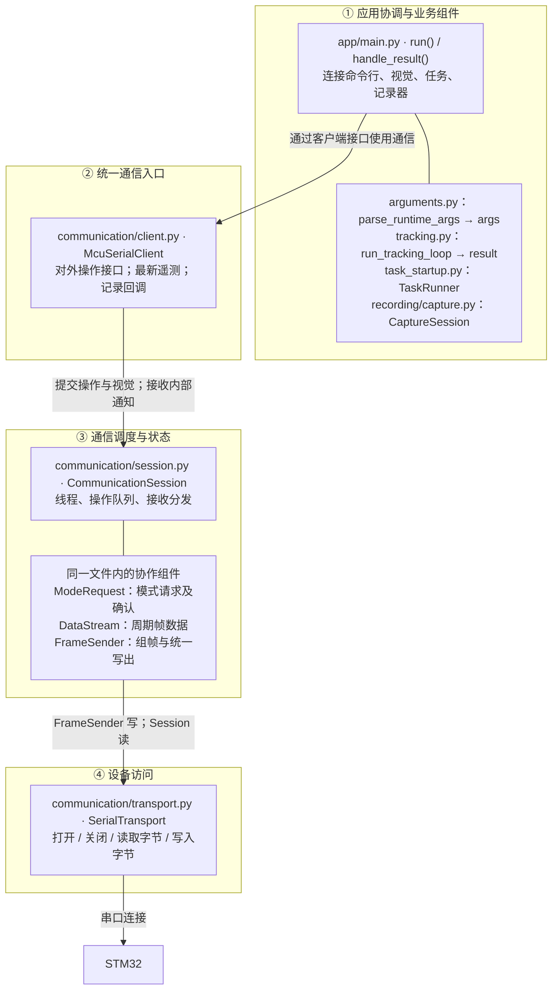
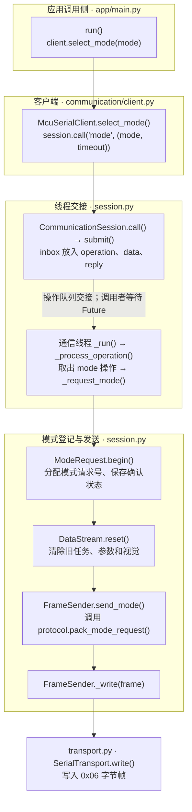
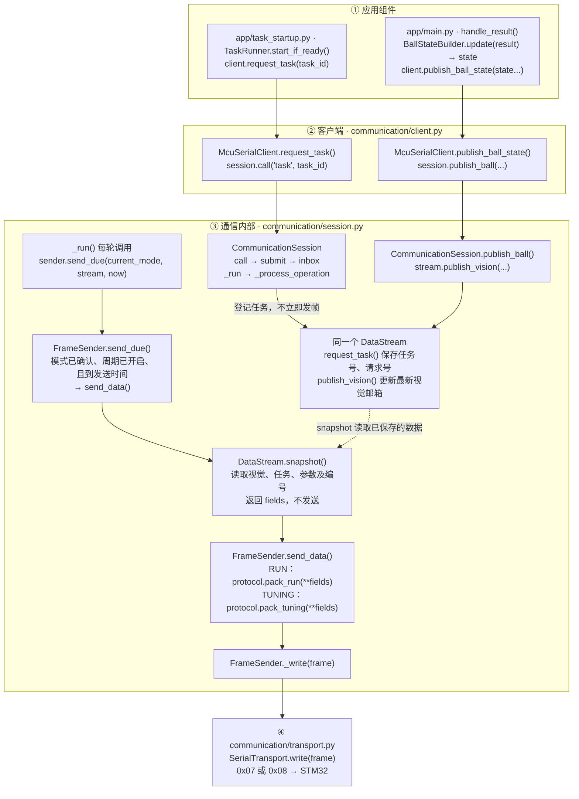
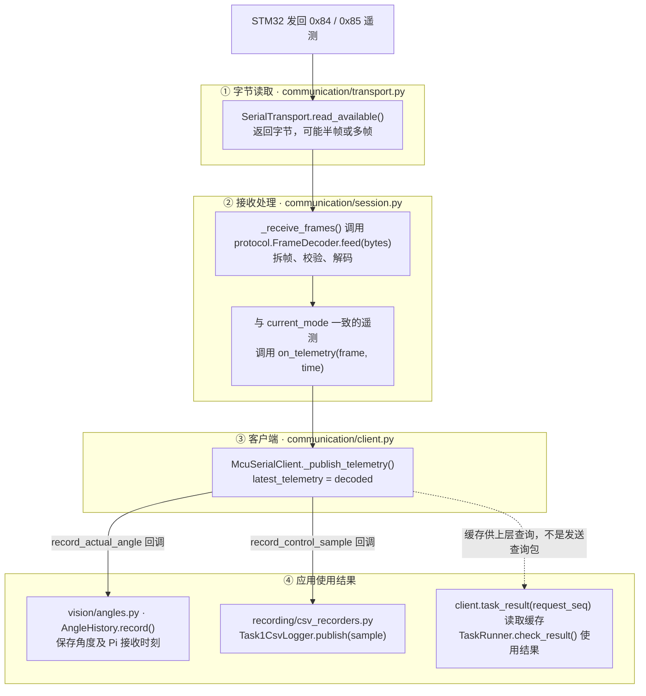

# 上位机通信链路：分层与调用图

核对日期：2026-10-20。按当前源码绘制，仅整理说明，不修改运行代码。

## 阅读约定

- **图 1 看层次，不看执行先后。** 它只说明模块归属、上下层如何连接。
- **图 2～4 看调用。** 每张图只讲一个过程，不把发送与返回混在同一张图中。
- 图中路径相对于 `D:/26H-remake/26H_Remake_Raspderry/ballbeam/`。
- 箭头区分“调用”“队列交接”“读取已保存数据”，不要都理解成串口发送。
- `app` 是应用协调目录，不是“所有非通信代码”。视觉在 `vision/`，记录在 `recording/`。

## 图 1：先认层，再认模块

这张图是模块地图，箭头表示上层使用下层，**不是一次发送依次经过所有节点**。

`communication/protocol.py` 是通信层使用的**协议工具模块**，不是额外的串口层：
- FrameSender 调用 `pack_mode_request / pack_run / pack_tuning` 得到 bytes。
- Session 调用 `FrameDecoder.feed()`，得到解码后的模式应答或遥测。
- 打包器不写串口，解码器不自己读取串口。

### 同一份 session.py 内，谁保存什么

| 对象 | 保存什么 | 不负责什么 |
|---|---|---|
| `session.mode: ModeRequest` | current_mode、target_mode、seq、reply、deadline | 不组帧、不读写串口 |
| `session.stream: DataStream` | 最新视觉邮箱、task_id、request_seq、parameters、revision、packet_seq | 不决定发送周期、不组帧、不写串口 |
| `session.sender: FrameSender` | period、next_send_at、发送错误和失败计数 | 不决定具体任务的业务行为 |
| `session: CommunicationSession` | thread、inbox、操作分发表 | 不直接打包、不直接写串口 |

## 图 2：模式请求怎样发出去

只看发送方向。该过程**发送一次**，不是周期发送。

应答返回链单独看：

`STM32 0x86 → transport.read_available → decoder.feed → session._receive_frames → mode.receive → reply.set_result → client.select_mode 返回`。

无匹配应答时，由 `_run → mode.check_timeout()` 返回失败；写出失败则 `_request_mode → mode.fail()`。不自动重发。

## 图 3：任务和视觉在哪里汇合，在哪里周期发送

这张图只看 RUN/TUNING 周期帧。任务操作和视觉更新最终汇入**同一个 DataStream**，发送由通信循环单独驱动。

**两条线不要混淆：**
1. `request_task()` 登记内容并返回请求号；不直接启动一次串口发送。
2. `_run → send_due → send_data` 到期后取快照、打包、写串口。它读取的正是刚才登记的数据。

周期由 `main.run → client.start_stream(period) → session.call('stream', period) → sender.set_period(period)` 开启。没有任务请求时也能传视觉，request_seq=0 表示无任务动作。

TUNING 参数走：
`task_startup.initialize_velocity_test → client.set_velocity_parameters → session.call('parameters', (task_id, parameters)) → DataStream.set_parameters`，保存所属任务号、参数及版本，并将线上 request_seq 置0。它只配置参数、不触发运动；内部任务请求计数器继续保留，随后 request_task 分配新的非零请求号。TUNING 球速任务使用编号1，两端分别以协议常量维护，测试会检查一致性。

视觉出口在 main 中显式指定为 `BallStateBuilder(state_source=measurement_state)`。当前 source 选择测量位置（缺失时回退跟踪位置）和跟踪速度，不额外滤波。未来处理函数返回最终 BallState 后，Builder 不会再读取原始测量覆盖它，client 接口不变。

## 图 4：收到遥测后，怎样回到客户端和应用组件

只看 MCU 返回方向，不画反向发送箭头。

这三条支路用途不同：
- **角度反馈给视觉：** `FrameAngleSource.for_frame(image_time) → AngleHistory.angle_at() → tracking.process_frame()`。
- **控制数据记录：** `Task1CsvLogger.publish → CsvWriter.write → CsvWriteWorker.submit`，由 CSV 后台线程写盘。
- **任务确认：** `task_result()` 核对请求号及 status 的任务成功位。参数确认则用 `parameters_result(revision)` 核对版本及参数应用成功位。均不发送额外查询包。

`0x86` 模式应答在 Session 内交给 ModeRequest，**不经过**客户端的遥测回调。

## 应用如何连接这些模块

这些连接在 `app/main.py · run()`，不是各组件相互创建彼此：

| 连接代码 | 作用 |
|---|---|
| `client = McuSerialClient(...)` | 创建统一通信入口 |
| `angles = AngleHistory(...)` | 创建角度历史组件 |
| `client.record_actual_angle = angles.record` | 收到角度后交给角度历史 |
| `capture = CaptureSession(...)` | 创建可选记录器协调器 |
| `client.record_control_sample = capture.control.publish` | 将控制遥测交给记录器 |
| `client.record_sent_frame = capture.sent.publish` | 将实际成功写出的周期包交给记录器 |
| `tasks = TaskRunner(client, ...)` | 任务启动管理器通过同一个客户端提交和查询 |
| `result_handler=handle_result` | 视觉循环将 result 交给 main 的协调函数 |
| `angle_for_frame=frame_angles.for_frame` | 视觉循环通过角度接口获得图像对应角度 |

命令行组件生成 args，不直接操作串口。记录器接收回调或视觉结果，不直接调用串口。TaskRunner 当前类名仍是 TaskRunner；它是启动请求管理器，不在 Pi 上执行 MCU 控制任务。

## 单独理解发包日志

这条通知与“MCU 已收到”不是一回事：

`FrameSender.send_data → _write 成功 → stream.mark_sent → client._record_sent_frame → record_sent_frame → BallStateTxLogger.publish`。

客户端会据此更新 `visual_state_sent`。它表示本地最近一次成功写出的周期包视觉是否有效，不是 MCU 接收 ACK。

`capture.record_vision(result, state)` 记录的是视觉结果及提交给通信的状态；发包日志记录的是实际写出的周期包。这两者分开，才能排查提交与发送之间的问题。

## 从图定位源码

| 文件 | 建议先找的入口 |
|---|---|
| [app/main.py](D:/26H-remake/26H_Remake_Raspderry/ballbeam/app/main.py) | run、handle_result、回调赋值 |
| [app/arguments.py](D:/26H-remake/26H_Remake_Raspderry/ballbeam/app/arguments.py) | parse_runtime_args；配置合并在 config.py |
| [app/task_startup.py](D:/26H-remake/26H_Remake_Raspderry/ballbeam/app/task_startup.py) | initialize_task_startup、TaskRunner |
| [communication/client.py](D:/26H-remake/26H_Remake_Raspderry/ballbeam/communication/client.py) | start、select_mode、request_task、publish_ball_state |
| [communication/session.py](D:/26H-remake/26H_Remake_Raspderry/ballbeam/communication/session.py) | _run、_process_operation、_request_mode、FrameSender |
| [communication/protocol.py](D:/26H-remake/26H_Remake_Raspderry/ballbeam/communication/protocol.py) | pack_*、FrameDecoder |
| [communication/transport.py](D:/26H-remake/26H_Remake_Raspderry/ballbeam/communication/transport.py) | read_available、write |
| [app/tracking.py](D:/26H-remake/26H_Remake_Raspderry/ballbeam/app/tracking.py) | TrackingComponents 保存组件；build_tracking_components 创建组件；process_frame、run_tracking_loop 组织逐帧运行 |
| [vision/angles.py](D:/26H-remake/26H_Remake_Raspderry/ballbeam/vision/angles.py) | AngleHistory、FrameAngleSource |
| [recording/capture.py](D:/26H-remake/26H_Remake_Raspderry/ballbeam/recording/capture.py) | open、start、record_vision、close |

## 线程边界

- 调用侧运行配置解析、视觉循环、TaskRunner；call/submit 用操作队列交给通信线程。call 等待结果，但不占用通信线程执行等待。
- publish_ball 直接更新线程安全的最新视觉邮箱，不等待通信线程或 MCU。
- McuCommunication 线程组织串口读写、请求处理、模式确认及周期发送，也调用客户端和记录回调。
- 配套记录器快速入队，CSV 写盘由共享 CsvWriteWorker 后台线程完成。
- client.start 打开串口并启动线程；普通退出先停止发送和通信，再关闭记录文件。task-console 的 Ctrl+C 当前使用 os._exit(130)，不保证清理和排空日志，需手动复位 MCU。
