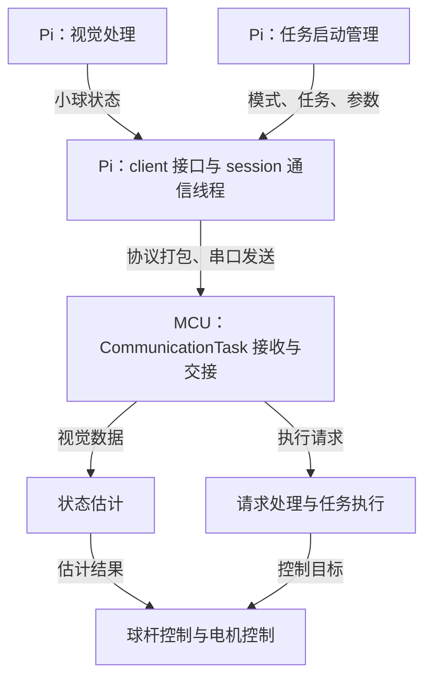
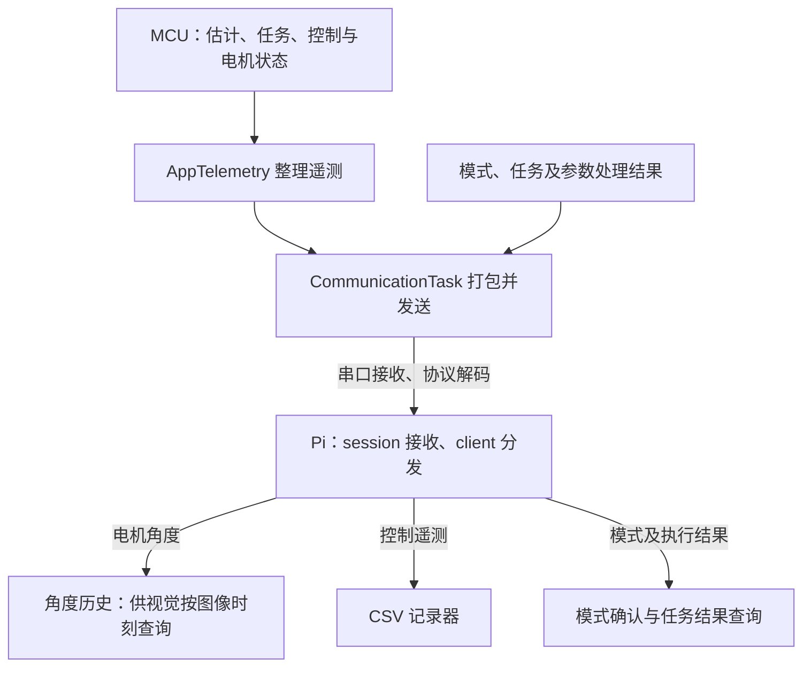

# 项目架构

项目由 Pi 视觉程序、STM32 实时控制程序和 Support 离线工具组成。Pi 负责测量与请求，MCU 负责估计与执行，Support 负责资料制作和实验分析。

设计以业务职责为边界：上层组装组件，通过接口交接数据；算法、通信和任务各自管理自己的状态。目录和类服务于这些职责，一个文件可以包含多个边界清楚的组件。

## 整体工作链

**请求与控制：Pi → MCU → 电机**

**遥测返回：MCU → Pi → 视觉与记录**

模式应答由通信任务单独打包；任务和参数结果随遥测返回。两张图拆开展示同一系统的去程和回程，箭头表示数据流，不代表每个组件各有一个线程。Support 不在这条实时链中，它为视觉提供模型和标定，并读取实验记录进行分析。

## Pi：组装、视觉与通信

`ballbeam/app/main.py` 创建组件、连接回调并管理生命周期；`app/tracking.py` 组织视觉循环。视觉节点完成角度匹配、展开、检测与跟踪，`vision/ball_state.py` 生成通信所需的最终状态。任务定义和启动请求管理位于 `app/task_startup.py`，具体任务规则不放进视觉或通信循环。

通信入口是 `communication/client.py`，应用组件通过它提交状态、请求任务和获取遥测。`session.py` 在唯一通信线程内处理操作队列、模式确认和周期发送；`protocol.py` 负责帧编解码，`transport.py` 负责串口字节读写。视觉更新通过最新值邮箱交接，不必跟随串口发送周期。

接收遥测后，客户端更新缓存，并通过回调交给角度历史和记录器。视觉随后查询图像对应的角度；记录器负责写盘，回调不能同步等待通信线程。记录和显示组件消费数据，不承担控制决策。

## MCU：调度、请求与控制

`APP/inc、src` 放 RTOS 调度、硬件回调和任务间交接。`Application` 按 Communication、BallBeam、MotorTest 组织业务，各组配套 `inc、src`；`UserLib/inc、src` 放 PID、电机控制等底层组件，不引用球杆业务。

三个主要执行位置承担不同工作：

| 执行位置 | 职责 | 交给下一步的内容 |
|---|---|---|
| `CommunicationTask` | 接收完整帧，调用协议解码，保存视觉与请求；发送模式应答和遥测 | 最新视觉、待处理请求及处理结果 |
| `BallStateTask` | 持有估计器，按节拍采用视觉测量并更新估计 | 带有效位的最新位置、速度估计 |
| `GimbalTask` | 执行调试命令、调用任务与控制器、处理 Pi 请求、运行电机控制 | 电机动作，以及供遥测读取的业务状态 |

`PiRequestHandler` 在 GimbalTask 中解释模式、任务和参数请求，调用 `BallBeamTasks` 并报告结果。任务对象管理目标、阶段及退出条件；`BallBeamController` 根据目标和估计结果计算电机目标角度。它们都是普通业务组件，不各自创建 RTOS 任务。`AppTelemetry` 只整理状态，协议层将其打包，通信任务负责发送。

## 接口与状态归属

| 数据或状态 | 归属与约定 |
|---|---|
| 最终视觉输入 | Pi 交付 `BallState(position_cm, velocity_cm_s, valid, measured_at)`；通信不猜选原始诊断字段 |
| 时间 | 图像时刻取 Pi 读取完成时刻，角度历史取 Pi 收到遥测时刻；MCU 使用本机接收时间与估计时间，不能直接当作同一时钟 |
| 发送与请求状态 | Pi 通信线程持有模式、待发任务和参数、发送周期；`seq` 区分包，`request_seq` 区分任务请求，`revision` 区分参数版本 |
| 算法与任务状态 | MCU 估计器持有估计历史，任务对象持有任务阶段，控制器持有控制历史；任务间读取复制后的结果，不直接修改这些内部状态 |
| 结果语义 | 模式确认、参数应用、任务启动、机械到位、运动完成分别判断，不能相互代替 |

Support 的工具串口客户端独立于正式 Pi 客户端，线上协议改动时必须同步检查。完整字段布局见 [协议约定](26H_Remake_Raspderry/ballbeam/communication/README.md)。

## 利用Agent扩展时保持的边界

替换视觉算法时，保持最终 `BallState` 接口，只修改对应节点及必要配置与组装。新增已有帧能表达的任务时，扩展 Pi 任务定义和 MCU 请求绑定、任务实现，通用发送器不解释新任务号。新增调参业务的校验和应用规则属于对应任务；现有字段不足时，才协调两端协议与 Support 工具。记录列和展示的变化归对应记录器、分析器和显示组件，不进入控制算法。

这些边界用于限制改动传播，不保证任何新业务都只改一个文件。源码入口和操作命令由各工程 README 维护；修改与验证要求由 `AGENTS.md` 维护。
